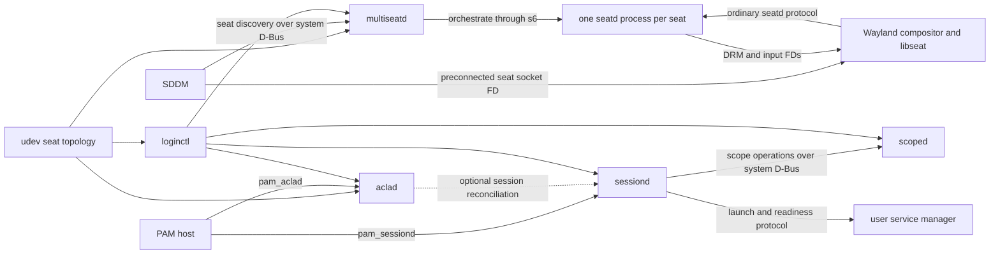
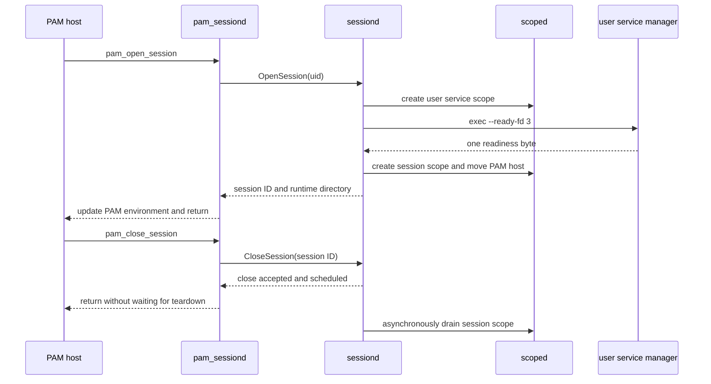
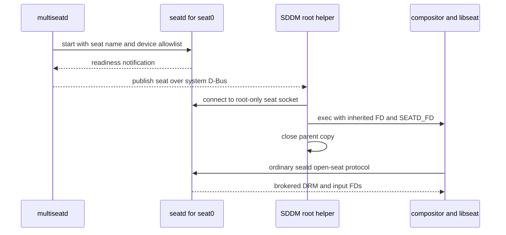

# SGLogin architecture

SGLogin is an umbrella project for a suite of independently installable
components that provide login sessions, process containment, seat management,
device access, and per-user service lifecycle without putting all of those
responsibilities in one daemon.

This is a suite, not a single service. Its components have separate state,
interfaces, and failure boundaries. A system can use the session stack without
the graphical seat stack, or the seat stack without session management.

This document describes the architecture and the contracts between components.
Details that belong entirely to one component—such as how `scoped` implements
whole-scope termination—belong in that component's repository instead.

> [!NOTE]
> SGLogin is the umbrella name. Some current repository names, package names,
> filesystem paths, and D-Bus interfaces retain the earlier `decoupling` name.
> Those identifiers are written as they exist today.

## Goals and principles

SGLogin follows these principles:

- **Separate authorities.** Seat topology, seat access, login sessions, process
  containment, and device ACLs have different owners.
- **Narrow interfaces.** Components exchange semantic operations over D-Bus,
  PAM, process-launch protocols, Unix sockets, and inherited file descriptors.
  They do not share private state.
- **Independent installation and failure.** Unrelated login paths should not
  depend on the graphical seat stack, and the seat stack should not depend on
  session management.
- **Explicit policy.** Display-manager backends, PAM participation, seat
  refresh, and user-service selection are configured explicitly rather than
  inferred through fallback chains.
- **Replaceable integrations.** The user service manager is selected through a
  small executable protocol. Platform-specific process containment is isolated
  behind `scoped` rather than embedded in `sessiond`.
- **Daemon-side authorization.** Administrative tools are clients, not security
  boundaries. Services authenticate their callers and enforce their own policy.

The suite does not currently provide an `org.freedesktop.login1` compatibility
service.

## Terminology

Several objects with different owners and lifetimes participate in one login.
They should not be treated as interchangeable.

| Term | Meaning |
| --- | --- |
| **Seat** | A named collection of display and input devices derived from the udev seat model. |
| **Login session** | An authenticated login lifetime owned by `sessiond`. A session may be graphical, a Linux virtual-terminal login, or a seatless login such as SSH. |
| **Scope** | A process-containment unit owned by `scoped`. Session and user-service processes live in different scopes. |
| **Seat client** | A compositor's connection to one seatd instance. A seat client is not itself a login session. |
| **User service manager** | One per-user service graph shared by that user's concurrent login sessions. |
| **ACL grant** | `aclad`'s association of a login session and user with one seat for device-node permission management. |

## Repositories and components

### Core services

| Repository | Responsibility |
| --- | --- |
| [`scoped`](https://github.com/shaitan-machine1/scoped) | Owns the managed process-scope hierarchy, process membership, and scope lifecycle operations. |
| [`sessiond`](https://github.com/shaitan-machine1/sessiond) | Owns login sessions, `/run/user/<uid>`, user-service-manager lifecycle, `pam_sessiond`, and the privileged user-manager launcher. |
| [`aclad`](https://github.com/shaitan-machine1/aclad) | Owns session-associated device ACL grants and `pam_aclad`. |
| [`seat-udev`](https://github.com/shaitan-machine1/seat-udev) | Defines the shared udev seat model and installs the rules that create its seat properties and tags. It is a library and policy repository, not a daemon. |
| [`multiseat`](https://github.com/shaitan-machine1/multiseat) | Turns snapshots of the udev seat model into one supervised seatd process and one root-only socket per published seat. |

### Integrations and forks

| Repository | Responsibility |
| --- | --- |
| [`seatd`](https://github.com/shaitan-machine1/seatd) | Fork of [seatd/libseat](https://git.sr.ht/~kennylevinsen/seatd). It supports configured per-seat instances, static device allowlists, and adoption of a preconnected seat socket through `SEATD_FD`. |
| [`sddm`](https://github.com/shaitan-machine1/sddm) | Fork of [SDDM](https://github.com/sddm/sddm). It adds explicit multiseatd discovery and delegates a seat connection to supported compositor lineages. |

### Administration and distribution integration

| Repository | Responsibility |
| --- | --- |
| [`loginctl`](https://github.com/shaitan-machine1/loginctl) | Provides one administrative client for seats, sessions, scopes, ACLs, and PAM activation. Each command contacts only the component it needs. |
| [`decoupling-logind-artix-packages`](https://github.com/shaitan-machine1/decoupling-logind-artix-packages) | Contains the current Artix packages, system service definitions, and the current s6 implementation of the user-service-manager entrypoint. |

The Artix packaging is one integration of the component architecture, not the
architecture itself. In particular, s6 is the current supervisor and user
service manager implementation, but `sessiond` interacts with a user service
manager through the protocol documented below rather than through an s6 API.

## System overview

The following diagram shows the principal runtime interactions. Solid arrows
are direct calls, process launches, or descriptor transfers. The udev arrows
represent independent consumers of the same topology rather than calls between
those consumers.



The diagram deliberately has no single central daemon. The seat path
and session path meet only at explicit login integration points: SDDM delegates
the seat connection and supplies seat metadata to PAM, while `pam_aclad`
associates that metadata with the login session. There is no combined
seat-and-session authority.

## Ownership and sources of truth

| State or resource | Authority |
| --- | --- |
| Persistent seat assignment and current seat membership | udev properties interpreted through `seat-udev` |
| Published graphical seats and their immutable deployed configurations | `multiseatd` |
| The active client of a seat and brokered device descriptors | that seat's seatd process |
| Login session identity and runtime-directory lifecycle | `sessiond` |
| Process membership and containment | `scoped` |
| Session-to-seat device grants and resulting device ACLs | `aclad` |
| PAM stack policy | the distribution or administrator |
| Contents and implementation of the per-user service graph | the selected user service manager |

`aclad` is an intentional bridge between two otherwise independent domains. It
combines session identity supplied through PAM with seat-device topology from
udev. This avoids teaching seatd about users and login sessions, or teaching
`sessiond` about seats and devices.

## Communication boundaries

### Components that communicate directly

- `sessiond` asks `scoped` to create, populate, terminate, and observe process
  scopes.
- `pam_sessiond` calls `sessiond`; `pam_aclad` calls `aclad`.
- `aclad` can observe `sessiond`'s session inventory and removal events. This
  integration is optional: without `sessiond`, normal PAM grant and revoke
  calls still work.
- SDDM discovers graphical seats from `multiseatd` over the system bus.
- SDDM connects directly to the selected seatd socket before launching a
  compositor.
- A compositor uses libseat to speak the ordinary seatd protocol over the
  inherited connection.
- `sessiond` invokes the selected user service manager through the executable
  and readiness protocol described below.
- `loginctl` uses each daemon's public D-Bus protocol independently. Seat
  assignment commands use the `seat-udev` library directly.

### Components that deliberately do not communicate

- seatd does not know about users, PAM sessions, runtime directories, cgroups,
  or ACL grants.
- `scoped` does not interpret seats, users, or login-session semantics. Scope
  and target names are opaque to it.
- `sessiond` does not know about seats, udev topology, device ACLs, compositors,
  or display managers.
- `multiseatd` does not know which users or login sessions occupy its seats.
- Compositors do not call `multiseatd`, `sessiond`, `scoped`, or `aclad`.
- SDDM does not manipulate cgroups or device ACLs directly.
- `loginctl` is not a coordinating service and does not make authorization
  decisions on behalf of daemons.

There is no hard runtime dependency between the seat stack and the
`scoped`/`sessiond` stack. `aclad` has no hard dependency on `sessiond`.

## Session integration contracts

### PAM open-session contract

`pam_sessiond` connects an existing PAM login path to session
management. The process hosting the PAM transaction is significant: `sessiond`
uses the authenticated D-Bus caller credentials to identify its PID rather than
accepting a caller-supplied PID.

A successful open operation has this sequence:

1. `pam_sessiond` resolves the authenticated user and calls
   `OpenSession(uid)` as part of `pam_open_session`.
2. `sessiond` creates or validates `/run/user/<uid>`.
3. If this is the user's first login session, `sessiond` starts the user's
   service manager and waits for the manager's readiness notification.
4. `sessiond` creates a new session scope through `scoped`.
5. `sessiond` moves the PAM host into that scope and tracks it as the session
   leader. Processes subsequently created by that host inherit session-scope
   membership.
6. `sessiond` returns an opaque session ID and the runtime-directory path.
7. `pam_sessiond` adds `XDG_SESSION_ID` and `XDG_RUNTIME_DIR` to the PAM
   environment before returning.

The first managed login therefore does not complete its `pam_sessiond`
open-session operation until the user service manager reaches its declared
readiness boundary. Concurrent sessions for the same user reuse the existing
manager.

This does not mean that a session-management failure must deny the login.
Authentication commonly precedes `pam_open_session`, and PAM policy decides
whether a module failure denies access. It is recommened to install
`pam_sessiond` and `pam_aclad` as optional session modules so a broken daemon or
user service manager cannot lock an administrator out of TTY, SSH, or SDDM. A
login that continues after such a failure may lack its session
environment or expected device access.

### PAM environment and ordering

The required semantic order is:

```text
pam_sessiond
pam_aclad
pam_env
```

- `pam_sessiond` establishes `XDG_SESSION_ID` and `XDG_RUNTIME_DIR`.
- `pam_aclad` consumes the session ID and, when present, seat metadata to apply
  device ACLs before its open-session call returns.
- A later distribution `pam_env` invocation may derive legacy environment such
  as `DBUS_SESSION_BUS_ADDRESS` from `XDG_RUNTIME_DIR`.

`sessiond` deliberately does not require a user D-Bus bus to exist and does not
synthesize `DBUS_SESSION_BUS_ADDRESS` itself.

PAM closes session modules in reverse order. Normal close therefore asks
`aclad` to revoke device access before asking `sessiond` to close the session.
`sessiond`'s eventual `SessionRemoved` event is a second revocation source for
unclean exits or a missed normal PAM close.

### PAM close-session contract

`pam_sessiond` does not wait for the session scope to disappear. `CloseSession`
accepts and records an idempotent close request, schedules teardown, and
returns. `sessiond` then tears down the session scope asynchronously. After
its teardown procedure completes it publishes session removal; after a user's
last session it also shuts down the user service manager and removes the runtime
directory according to configured policy.

Asynchronous close is required by the process model. The process running PAM—
for example an SDDM root helper, an OpenSSH privileged monitor, or the parent of
a console login—is itself the tracked leader inside the session scope. Waiting
for that scope to become empty would require the caller to wait for its own
termination. Returning first lets the PAM host finish its close path while
session teardown proceeds independently.

The PAM host's unexpected disappearance is also session-lifecycle evidence.
`sessiond` observes leader loss through `scoped`, so cleanup does not depend
only on a successful `pam_close_session` call.

### User service manager entrypoint protocol

The user service manager is replaceable. `sessiond` owns when it should exist,
the runtime directory, its process scope, and its startup timeout. A selected
manager package owns the service graph and implements this process protocol.

`sessiond` uses a privileged launcher to perform credential and PAM setup
outside its multithreaded daemon process. The launcher then invokes the selected
entrypoint as the target user. The conventional path and current invocation
are:

```text
/usr/libexec/user-service-manager --ready-fd 3
```

The entrypoint must use the descriptor named by `--ready-fd`; the protocol is
defined by the argument, not by an implicit assumption about fd 3.

The manager receives a clean environment containing at least:

```text
HOME
USER
LOGNAME
SHELL
PATH
XDG_CONFIG_HOME
XDG_RUNTIME_DIR
```

It must not assume that a user D-Bus bus exists or that
`DBUS_SESSION_BUS_ADDRESS` is set.

The readiness contract is:

- the manager writes one byte, of any value, to the readiness descriptor;
- it writes that byte only after reaching its documented startup boundary;
- EOF, an error, early process exit, or timeout before one byte is a startup
  failure;
- readiness need not mean that every optional service in the user's graph has
  completed startup; and
- after receiving one byte, the launcher closes its side without expecting a
  larger message.

The lifetime contract is:

- the manager remains in the foreground and does not daemonize or double-fork;
- pre-readiness failure produces a nonzero exit;
- `SIGTERM` asks the manager to bring down its service graph;
- the manager waits for supervised children to drain before exiting; and
- the surrounding `scoped` scope remains the final containment and timeout
  boundary if graceful shutdown fails.

The complete first-session interaction is:



For a later concurrent session, the existing healthy user service manager is
reused and the launch/readiness portion is skipped.

## Seat model and environment contract

### Seat topology

`seat-udev` installs the rules that define the Linux udev seat model used by
the suite. Among other data, that model provides:

- `ID_SEAT`, with the conventional absence of an explicit value meaning
  `seat0`;
- `seat` and `master-of-seat` tags used to determine seat membership and
  whether a usable seat exists;
- stable assignment identifiers; and
- `uaccess` tags identifying device nodes whose ACLs may need management.

`multiseatd` and `aclad` consume this model independently. `multiseatd` uses a
fresh snapshot at startup and on explicit refresh to create a static per-seat
device allowlist. `aclad` monitors the relevant udev state so it can recompute
ACLs when applicable devices appear, disappear, or move.

A topology change does not silently replace a running graphical seat.
Administrators explicitly request a refresh. Replacing or removing a changed
seat is disruptive and may terminate its graphical session.

### Who supplies `XDG_SEAT`

No component universally assigns a seat to every login.

| Login origin | Seat source |
| --- | --- |
| SDDM greeter or user session | SDDM sets `XDG_SEAT` to the actual seat it is starting, such as `seat0` or `seat1`, before calling `pam_open_session`. |
| Linux virtual-terminal login | If `XDG_SEAT` is absent, `pam_aclad` recognizes `PAM_TTY=ttyN` or `/dev/ttyN` and treats the login as belonging to `seat0`. |
| SSH or a generic pseudoterminal | No seat is inferred and no seat-device ACL grant is made. |

`sessiond` does not set or interpret `XDG_SEAT`. For SDDM sessions, SDDM places
its session environment into the PAM environment before opening the PAM
session. `pam_aclad` reads `XDG_SEAT` from there, combines it with the session
ID from `pam_sessiond` and the authenticated UID, and asks `aclad` to grant that
session access to the seat's applicable devices.

## Seat connection delegation

SDDM delegates access to a selected seat by handing the compositor a
preconnected seatd socket file descriptor. The descriptor is not a DRM or input
device itself: it is a connection through which libseat asks seatd to broker
those device descriptors.

This mechanism is needed because each per-seat socket is root-owned and mode
`0600`, while the compositor runs as an unprivileged user. It also keeps the
choice of graphical session out of seatd and the details of device opening out
of SDDM.

### Descriptor handoff contract

1. Each graphical seat published by `multiseatd` has one running seatd process,
   one root-only socket, and one static device allowlist.
2. SDDM discovers the seat through `multiseatd`, but D-Bus is not used to
   transfer the seat connection.
3. Immediately before starting a supported seat-owning Wayland process, the
   root SDDM helper opens a fresh connection to that seat's socket.
4. SDDM passes the connection's actual descriptor number through `SEATD_FD`
   and selects the seatd backend through `LIBSEAT_BACKEND=seatd`.
5. Only the intended compositor lineage inherits the open descriptor. Parent
   helpers, the QML greeter, and unrelated children must close it or never
   receive it.
6. Patched libseat adopts the preconnected socket, removes the delegation
   variable from the environment, restores close-on-exec behavior, and then
   uses the ordinary seatd protocol.
7. seatd still enforces active-client state and its configured device
   allowlist. Possession of the connection does not bypass seatd policy.
8. SDDM closes its copy after successful child startup. When the compositor
   lineage closes its final copy, socket EOF ends that seat client.

A fresh connection is delegated for each greeter or user compositor lineage.
Connections are not reused between sessions.



The current delegation path is for supported Wayland compositor lineages. SDDM
does not pass an unused seat connection to X11 sessions; doing so would not add
libseat support to Xorg or make a privileged Xorg path obey the seatd allowlist.

## End-to-end lifecycle

### System startup

There is no mandatory full-suite startup chain.

- `scoped` requires the system bus and its process-containment backend.
- `sessiond` starts after `scoped` when session management is installed.
- `aclad` requires the system bus and completed udev initialization, but not a
  running `sessiond`.
- `multiseatd` requires the system bus and a completed udev snapshot. It
  converges desired seats into supervised seatd processes and publishes a seat
  only after that process is ready.
- An SDDM multiseat deployment starts after `multiseatd`. If the multiseatd
  D-Bus owner disappears, SDDM removes the advertised seats and relists them
  when the owner returns.

### Graphical login

1. SDDM creates a display for a seat published by `multiseatd` and supplies the
   seat name in the session environment.
2. Its root helper authenticates the user and calls `pam_open_session`.
3. `pam_sessiond` ensures the user service manager is ready, creates the login
   session, moves the helper into the session scope, and publishes the session
   environment.
4. `pam_aclad` grants the session's user access to that seat's applicable
   `uaccess` devices.
5. SDDM opens a fresh connection to that seat's seatd process and delegates it
   only to the selected compositor lineage.
6. The compositor calls the ordinary libseat API. seatd activates the
   appropriate seat client and returns only devices in that seat's allowlist.

The PAM/cgroup path and the seat-connection path are separate. They are joined
by SDDM's knowledge of the selected seat and by the PAM environment, not by a
direct dependency between `sessiond` and seatd.

### Normal graphical logout

1. The compositor exits and its seat connection closes, allowing seatd to
   remove the client and revoke brokered devices where the device API permits.
2. The SDDM helper closes its PAM session.
3. PAM's reverse close order asks `aclad` to revoke the session's ACL grant,
   then asks `sessiond` to close the session.
4. `sessiond` accepts the request and returns without waiting for teardown.
5. Asynchronously, `sessiond` uses `scoped` to tear down the session scope and
   then publishes `SessionRemoved`.
6. If this was the user's last session, `sessiond` shuts down the user service
   manager and removes the runtime directory as the final part of user
   teardown.
7. SDDM may start a new greeter with a new seat connection independently of
   the old session's asynchronous process cleanup.

### TTY and SSH login

TTY and SSH sessions use the same session-management contract without the
compositor or seat-connection path:

- `pam_sessiond` creates a session scope and supplies the runtime/session
  environment;
- concurrent logins share the user's service manager;
- a Linux VT can receive a `seat0` ACL grant through `PAM_TTY`; and
- SSH and generic PTY sessions remain seatless and receive no seat-device ACL
  grant.

This separation is intentional: login sessions do not require graphical seats.

## Security and failure boundaries

- SGLogin daemons use the system bus. Mutating service operations are generally
  root-only, with any documented read-only exceptions.
- Services authenticate D-Bus peer credentials themselves. Installed bus
  policy is defense in depth. `loginctl` is an ordinary non-setuid client and
  never invokes `sudo`.
- Seat sockets are root-only. SDDM is trusted to delegate one connection to the
  selected compositor lineage.
- seatd returns only devices allowed by that seat's immutable configuration and
  only according to its active-client rules.
- Recommended PAM integration is fail-open to preserve an administrative login
  path. Fail-open prevents lockout; it does not promise that software requiring
  a runtime directory, service manager, or device grant will work.
- Removing a filesystem ACL cannot revoke a descriptor that an application has
  already opened. ACL revocation, seatd descriptor brokering, and session-scope
  teardown therefore provide different parts of the lifecycle boundary.
- `aclad` persists grants and can reconcile them against `sessiond` when it is
  available. Without `sessiond`, it continues to serve PAM but has weaker
  cleanup after an unclean PAM-host exit.
- `scoped`, `sessiond`, and `aclad` reconstruct their relevant logical state
  from their owned runtime state after restart. Restarting a seatd instance
  invalidates its clients; connected compositors are expected to observe EOF
  and exit.
- Automatic display-manager recovery after a deliberately killed compositor or
  seatd process is not currently part of the contract.

## Portability boundary

The complete current implementation is Linux-specific. It uses cgroup v2,
Linux process facilities, udev, Linux-PAM, DRM, and Linux input-device APIs.

The architecture nevertheless aims to keep domain contracts Unix-oriented and
to isolate platform mechanisms behind their owning components:

- `sessiond` deals in login sessions, opaque scopes, runtime directories, and
  process-launch/readiness contracts. It does not manipulate cgroup files.
- `scoped` translates semantic process-containment operations into the current
  Linux backend. Platform details do not appear in the `sessiond` contract.
- Seat access is delegated through a Unix file descriptor and spoken through
  the libseat/seatd protocol rather than through Linux device operations in
  SDDM.
- The user service manager is selected through an executable, environment,
  readiness descriptor, signals, and foreground process lifetime rather than
  an s6-specific API.

This separation is intended to permit alternative Unix platform backends over
time. It is a portability direction, not a claim that the current suite already
runs on non-Linux systems.

## Current architectural debt

The seat and ACL design currently uses udev both as a topology-description
mechanism and as input to access-control decisions. This matches existing Linux
userspace: compositors and libinput select devices using udev seat properties,
while `uaccess` tags identify device nodes conventionally associated with an
active local user.

The cost is that several independent consumers must agree on the same udev
model, and device-node access requires login-time grant and revoke bookkeeping.
SGLogin treats this as a compatibility mechanism rather than the desired
long-term authority model. Its longer-term direction is to reduce reliance on
applications independently deriving usable devices from udev, in favor of
broker-mediated discovery and file-descriptor access where suitable ecosystem
interfaces exist. A concrete replacement protocol is not part of the current
architecture.

## Current limitations

- No logind or systemd D-Bus APIs. GNOME won't work.
- Polkit active-session integration, inhibitors, suspend/lock integration, and power policy are not yet available.
- Compositor has to support normal libseat backend. Xorg, kwin, mutter don't support it.
- Changing a seat's device allowlist currently requires full multiseatd restart. Graphical sessions will be restarted.
- More than one graphical session on a single seat is not yet supported.
- Multi-seat operation still has known bugs and is under active development.

## Planned development

- Removing scope daemon, and only using a scopelib as a library. Non-linux OS wanting to use sessiond would have to reimplement scopelib, and maybe implement the daemon.
- Making sessiond's daemon smaller, only using it for asynchronous session teardown, while pam_sessiond does everything else.
- Polkit integration and power-management support.
- Logind and Systemd D-Bus APIs compatibility layer.
- Updating a seatd instance's device set without restarting it.
- Supporting multiple graphical login sessions on one seat remains possible future work, but does not yet have a committed design.

## Long term

- Ditch ACL and udev for seats, making proper device brokering with libseat - even for pipewire.

## Non-goals

- `loginctl` does not aim to reproduce systemd/elogind command syntax or output. Maybe that'll change.
- Merging seat, session, process-containment, and device access responsibilities back into one daemon.
